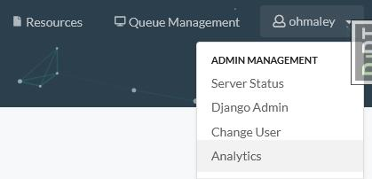

# Storage Analytics & Statistics

## Storage analytics

### The interface
The storage analytics page is accessible at [codabench-url/analytics/](https://www.codabench.org/analytics/) under the storage tab.



From this interface, you will have access to various analytics data:

- A Storage usage history chart
- A Competitions focused storage evolution, distribution and table
- A Users focused storage evolution, distribution and table

All of those data can be filtered by date range and resolution, and exported as CSVs.

The data displayed in those charts are only calculated from a background analytics task that takes place every Sunday at 02:00 UTC time (value editable in the `src/settings/base.py`).

### The background task

The analytics task is a celery task named `analytics.tasks.create_storage_analytics_snapshot`.
What it does:

- It scans the database looking for file sizes that are not set or flagged in error
- Actually measures their size and saves it in the database
- Aggregates the storage space used by day and by Competition/User (for example every day for the last year for each competition) by looking at the database file size fields
- For data related to the _Platform Administration_ it measures as well the database backup folder directly from the storage instance.
- Everything is saved as multiple snapshots in time in each Category table (e.g.: `UserStorageDataPoint`)
- This task also runs a database <-> storage inconsistency check and saves the results in a log file located in the `var/logs/` folder

To manually start the task, you can do the following:

- Start codabench `docker compose up -d`
- Bash into the django container and start a python console:
```sh
docker compose exec django ./manage.py shell_plus
```
- Manually start the task:
```python
from analytics.tasks import create_storage_analytics_snapshot
eager_results = create_storage_analytics_snapshot.apply_async()
```
- If you check the logs (`docker compose logs -f`) of the app you should see "Task create_storage_analytics_snapshot started" coming from the site_worker container
- If you have to restart the task, don't worry, it will only compute the size of the files that haven't been computed yet.
- Once the task is over you should be able to see the results on the web page

## Homepage counters

There is also a daily background task counting users, competitions and submissions, in order to display it on the homepage.

You can manually run it:

```bash
docker compose exec django ./manage.py shell_plus
```

```python
from analytics.tasks import update_home_page_counters
eager_results = update_home_page_counters.apply_async()
```

## Codabench Statistics

You can create two types of codabench statistics:

- Overall platform statistics for a specified year
- Overall published competitions statistics

Follow the steps below to create the statistics:

### Start codabench
```bash
docker compose up -d
```

### Bash into the django container and start a python console
```bash
docker compose exec django ./manage.py shell_plus
```

### For overall platform statistics
```python
from competitions.statistics import create_codabench_statistics
create_codabench_statistics(year=2024)
```
!!! note
    - If `year` is not specified, the current year is used by default
    - A CSV file named `codabench_statistics_2024.csv` is generated in `statistics` folder (for year=2024)

### For overall published competitions statistics
```python
from competitions.statistics import create_codabench_statistics_published_comps
create_codabench_statistics_published_comps()
```
!!! note
    A csv file named `codabench_statistics_published_comps.csv` is generated in `statistics` folder
