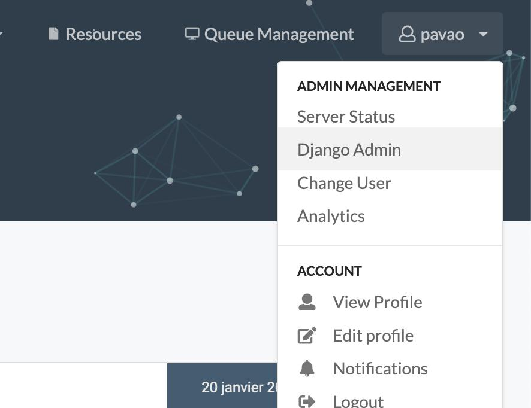
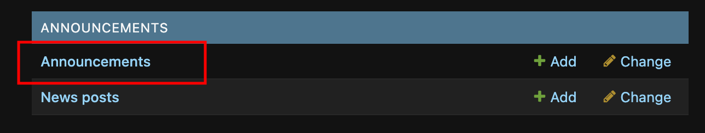
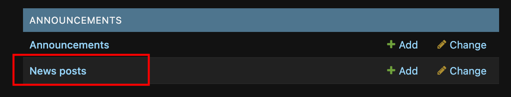
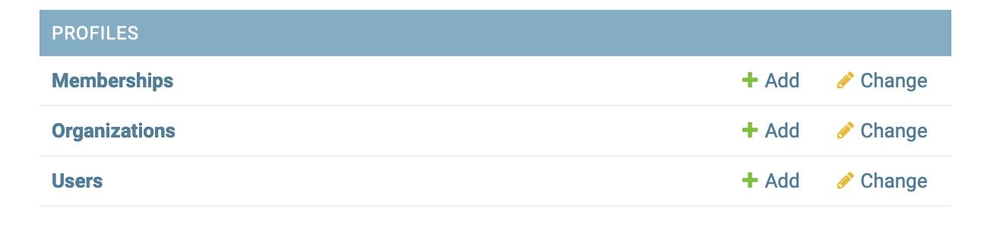
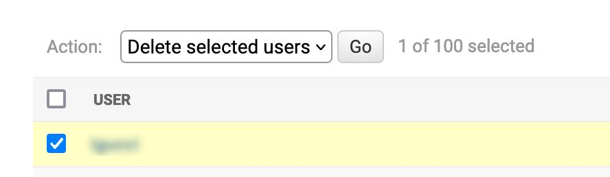
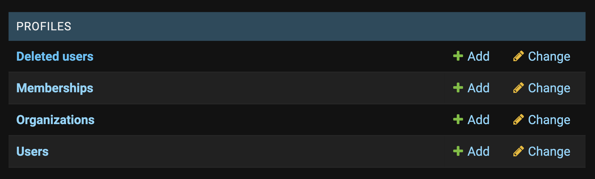

# Django Admin Interface

Once you log in to an account with superuser privileges, you have access to the "Django Admin" interface:

From this interface, you can change a user's quota, change their staff and superuser status, change the featured competitions displayed on the homepage, manage user accounts and more.

## Edit announcements

In the Django admin interface, click on `Announcements`:

Every announcement marked **Is active** is shown on the front page, inside the "Announcement" box. Each announcement has:

- **Title** (optional): shown in bold above the text.
- **Level**: controls the style.
    - `Critical`: red with an exclamation icon
    - `Warning`: yellow with a warning icon
    - `Info`: blue with an info icon
    - `Plain`: plain text with no background or icon
- **Text**: the body, written in HTML. Links are shown bold and underlined in the announcement's color.
- **Is active**: untick to hide an announcement without deleting it.
- **Priority**: controls the order. Lower numbers are shown first; announcements with the same priority are shown newest first.

You can create and edit announcements using the interface. Write the text using HTML to format it, add links, and more.

## Edit news

In the Django admin interface, click on `News posts`:

All news objects are read by the front page as separate news.
You can create and edit news using the interface. Write the news using HTML to format it, add links, and more.

## Delete a user

Go to `Users`:

Select it, select the `Delete selected users` action and click on `Go`:

## Ban/Unban a user

Go to `Users` in the `django admin`:

Search for user using the search bar, or use the filter on the right side. Click on the username of the user to open user details, scroll down to find `Is Banned`. Check/uncheck this option to toggle the banned status.
