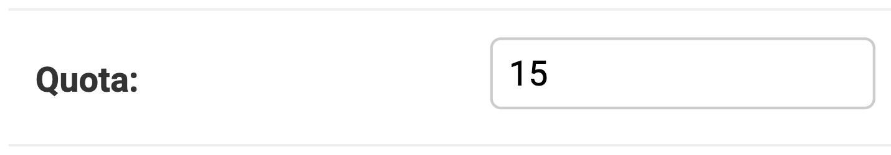

# User Quota Management

### Increase user quota

##### Using the Django Shell

```python
docker compose exec django ./manage.py shell_plus
```

```python
u = User.objects.get(username='<USERNAME>') ## can also use email
u.quota = u.quota * 3 # We multiply the quota by 3 in this example
u.save()
```

##### Using the Django Admin Interface
- Go to the Django admin page
- Click user table
- Select the user for whom you want to increase/decrease quota
- Update the quota field with new quota (in GB e.g. 15)


