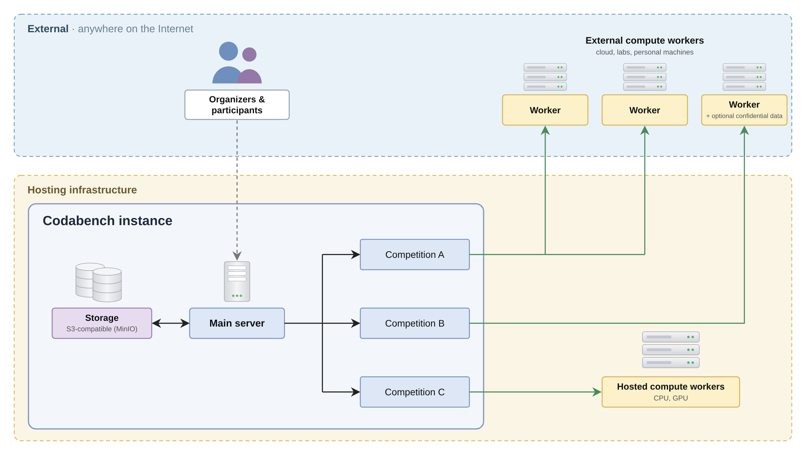

This page gives a general view of how a Codabench instance is organized. A Codabench instance is made of three parts: a **main server**, a **storage**, and **compute workers**. The main server and the storage are run by the administrators of the instance. Compute workers can be run by the administrators, or by the competition organizers on their own machines.

## Main server

The main server hosts the website and the API. Organizers and participants only interact with Codabench through it: creating competitions, uploading bundles, making submissions, viewing leaderboards.

It is made of several services, each running in its own Docker container:

- **Caddy:** web server and reverse proxy, handles HTTPS.
- **Django:** the Codabench application itself (website, API, websockets).
- **PostgreSQL:** the database, containing users, competitions, submissions, scores, etc.
- **RabbitMQ:** the message broker. It holds the queues of submissions waiting to be run by compute workers.
- **Site worker:** runs background tasks for Django, such as unpacking competition bundles or re-running submissions.
- **Redis:** cache, and storage of the background task results.
- **Flower:** monitoring tool for the background tasks.

More details on these services are given in [Codabench Docker Architecture](Codabench-Architecture.md).

## Storage

The storage holds all the files of the platform: competition bundles, datasets, ingestion and scoring programs, submissions, and their outputs and logs. The database only keeps references to these files.

Codabench uses S3-compatible storage. By default, the main server runs a [MinIO](https://min.io/) container next to the other services, but the storage can also be an external service such as AWS S3, Google Cloud Storage or Azure Blob Storage. This is set in the `.env` file with `STORAGE_TYPE` and the related variables.

Files are not sent through the main server when a submission runs: the main server gives the compute worker temporary signed URLs, and the worker downloads the files and uploads the results directly from and to the storage. This means the storage must be reachable from every compute worker.

## Compute workers

Compute workers are the machines that run the submissions. Each worker listens to one queue of the RabbitMQ broker. When a participant makes a submission, the main server sends a job to the queue used by the competition. A worker of that queue picks the job, downloads the submission and the task files from the storage, runs the ingestion and scoring programs in a Docker container, then sends back the logs, the results and the scores to the main server.

The connection is always opened by the worker, towards the broker and the main server. A worker therefore does not need a public IP address, and can run behind a firewall.

There are two kinds of compute workers:

- **Hosted compute workers** are run by the administrators of the instance, and are connected to the default queue. Competitions that do not specify a queue use them. They can provide CPU or GPU resources.
- **External compute workers** are run by competition organizers, on any machine: cloud, lab servers, or personal machines. Organizers create their own queue in [Queue Management](../Organizers/Running_a_benchmark/Queue-Management.md), assign it to their competition, and connect workers to it using the queue's broker URL. Several workers can listen to the same queue to process submissions in parallel, and the same queue can be shared between several competitions.

In the figure above, competition A uses two external workers, competition B uses one external worker, and competition C uses the hosted workers of the default queue.

External workers are also useful to keep data confidential: data placed directly on the worker machine can be read by the ingestion and scoring programs without ever being uploaded to Codabench. See [Put data directly inside the compute worker](../Organizers/Running_a_benchmark/Compute-Worker-Management---Setup.md#optional-put-data-directly-inside-the-compute-worker).

To set up a compute worker, see [Compute Worker Management & Setup](../Organizers/Running_a_benchmark/Compute-Worker-Management---Setup.md). The steps followed by a submission on the worker are detailed in [Submission Process Overview](Submission-Process-Overview.md) and [Submission Docker Container Layout](Submission-Docker-Container-Layout.md).
