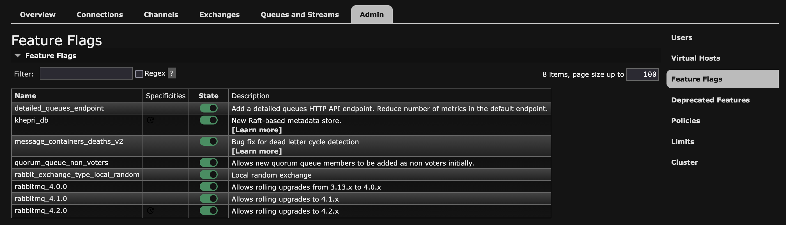

!!! tip "Recommended setting when upgrading from a version lower than [v1.28.0](https://github.com/codalab/codabench/releases/tag/v1.28.0)"

We recommend enabling all stable RabbitMQ feature flags. This can significantly speed up and stabilize your platform, especially if it has many vhosts (one per queue). On [codabench.org](https://www.codabench.org), RabbitMQ startup time went from ~5 minutes to ~10 seconds.

!!! warning
    Before enabling them, check that all these feature flags are compatible with your environment. A feature flag cannot be disabled once enabled.

You can enable them in one of these two ways:

- **From the RabbitMQ management interface**, in the **Admin > Feature Flags** tab. It is accessible from your site address on the port defined by `RABBITMQ_MANAGEMENT_PORT` in your `.env` file (15672 by default), with the username and password also defined in the `.env` file.



- **From the command line**, by running this command in the RabbitMQ container:

```sh
docker compose exec rabbit rabbitmqctl enable_feature_flag all
```

More information about [feature flags](https://www.rabbitmq.com/docs/feature-flags) and [Khepri, the new default metadata store](https://www.rabbitmq.com/blog/2025/09/01/6-khepri-default).
