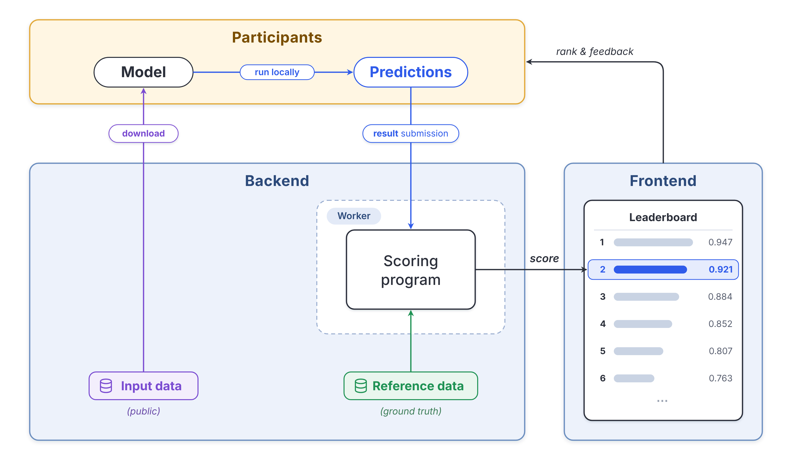
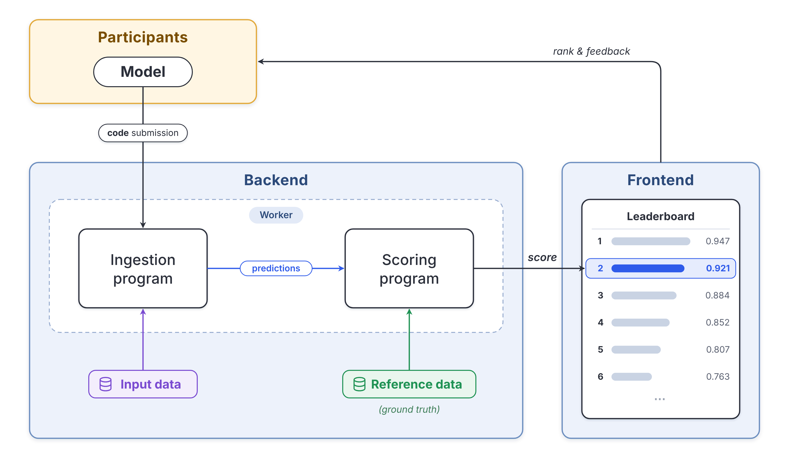
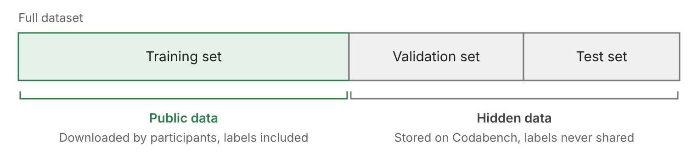
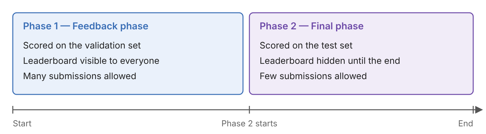
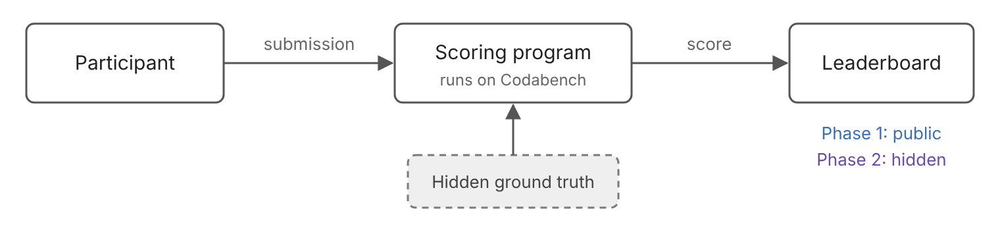

This page explains how a Codabench competition works and the main design choices you have to make before creating one: what participants submit, how their submissions are scored, and how the competition is divided into phases.

## Tasks

A competition is made of one or more **tasks**. A task defines how a participant's submission is turned into a score on the leaderboard. It has four components:

| Component | Required | Role |
|---|---|---|
| **Scoring program** | Yes | Takes the predictions and outputs a score for the leaderboard. |
| **Reference data** (ground truth) | No, but almost always present | The expected answers that the scoring program compares the predictions with. Never shown to participants. |
| **Ingestion program** | No | Runs the participant's code on the server, for example to train a model and make predictions. |
| **Input data** | No | The data the predictions are made on. It is given to the ingestion program, or downloaded by participants. |

The scoring program is the only component every task needs. The combination of the other three determines the design of the competition. More details on each component are given in [Competition Bundle Structure](Competition-Bundle-Structure.md#data-types-and-their-role).

## Result submission and code submission

There are two usual protocols, depending on whether participants submit their predictions or their code.

### Result submission

1. Participants download the **input data**.
2. They run their model on their own machine and get predictions.
3. They submit the **predictions** (the "results").
4. The **scoring program** compares the predictions with the **reference data** and sends the score to the leaderboard.

**Components used:** scoring program and reference data. The input data is given to participants, for example as the phase's public data.

**Advantages:** easy to set up and cheap to run, since participants use their own compute.

**Drawbacks:** participants see the test inputs. The organizers have no control over how the predictions were made, so they cannot enforce time limits, check reproducibility or prevent manual labelling.

### Code submission

1. Participants submit their **model as code**.
2. On the server, the **ingestion program** runs the model on the **input data** and writes predictions.
3. The **scoring program** compares the predictions with the **reference data** and sends the score to the leaderboard.

**Components used:** all four.

**Advantages:** the input data and the reference data stay hidden. Results can be reproduced, and the organizers control the time, memory and hardware available to submissions.

**Drawbacks:** more compute is needed, and the submission format and the [Docker image](Competition-docker-image.md) have to be set up with care.

### How Codabench runs a submission

A submission is processed on a compute worker, in up to two steps:

- **Prediction step:** only runs if the task has an ingestion program. The ingestion program finds the participant's code in `/app/ingested_program` and the input data in `/app/input_data`, and writes the predictions to `/app/output`.
- **Scoring step:** always runs. The scoring program finds the predictions in `/app/input/res` (the output of the prediction step, or the submitted files directly for a result submission) and the reference data in `/app/input/ref`. It writes a `scores.json` file to `/app/output`, whose keys match the [leaderboard columns](Yaml-Structure.md#leaderboards).

The full list of directories is given in [Submission Docker Container Layout](../../Developers_and_Administrators/Submission-Docker-Container-Layout.md#submission-container).

### Other designs

Since only the scoring program is required, the same framework covers other setups:

- **No reference data:** the scoring program measures the submission directly, for example its runtime or its model size, a quality metric computed from the output alone, or a judge model.
- **Ingestion program without input data:** the ingestion program contains its own environment or data generator, as in reinforcement learning, simulation or optimization tasks.
- **Different designs per phase:** each phase uses its own tasks, so a competition can for example have a result submission phase followed by a code submission phase.

## Data splits and phases

Most competitions follow the same principle: participants get some data to build their models, but they are evaluated on data they have never seen.

### Splitting the data

Start by splitting your dataset into three parts.

- The **training set** is the public data. Participants download it with its labels, and use it to develop their models on their own machine. It can be attached to a phase as `public_data`, or included in the `starting_kit`.
- The **validation set** and the **test set** are hidden data. They are uploaded to Codabench by the organizers as input data and reference data, and their ground truth is never shared with participants.

Keeping a separate test set is important. If participants could see its labels, or get unlimited feedback on the data used for the final ranking, they could overfit it.

!!! info "Keeping all the data hidden"
    With [code submission](#code-submission), the training data does not have to be public either. Put it in the task's input data: the ingestion program trains the participant's model on it, then makes predictions on the validation or test data, all on the server. Participants never see any of the data, which is useful for confidential datasets. You can still give them a small sample, or synthetic data, in the `starting_kit` so they can test their code locally. For data that must not be uploaded to Codabench at all, see [Put data directly inside the compute worker](../Running_a_benchmark/Compute-Worker-Management---Setup.md#optional-put-data-directly-inside-the-compute-worker).

### Organizing the phases

A competition is divided into phases. A typical setup has two phases, each scored on a different hidden set: the first phase uses a task with the validation data, and the second phase a task with the test data.

**Phase 1, feedback phase.** Submissions are scored on the validation set and the results appear on the leaderboard. Participants can submit many times, compare themselves to others and improve their method.

**Phase 2, final phase.** Submissions are scored on the test set, and this final leaderboard decides the ranking and the winners. Participants must not be able to tune their method on the test set, so they should get as little feedback on it as possible. There are two usual ways to do this:

- **One submission per participant:** set `max_submissions: 1` on the final phase. Each participant chooses the method they submit for the final ranking.
- **Automatic migration:** set `auto_migrate_to_this_phase: True` on the final phase. When it starts, the successful submissions of the feedback phase are re-run on the test set, so participants do not need to submit again.

The final phase's leaderboard can stay visible. It is empty until the phase starts, and with either of these setups, seeing the test scores does not give participants a chance to improve on them.

### What happens when a participant submits

In both phases, the evaluation happens on Codabench, so participants never handle the hidden ground truth themselves.

The participant sends a submission, either predictions or code. The scoring program compares it with the hidden ground truth and writes a score to the leaderboard of the current phase. What changes between the phases is the data used and how many submissions are allowed.

### Summary

| | Training | Validation | Test |
|---|:---:|:---:|:---:|
| Can participants access the ground truth? | Yes | No | No |
| Can participants get a score on it? | Yes, computed by themselves | Yes, many times, on the leaderboard | Only for their final submission |
| Can organizers get a score on it? | Yes | Yes | Yes |

## Next steps

- [Advanced Tutorial](Advanced-Tutorial.md): create a competition with the editor or from a bundle.
- [Competition Bundle Structure](Competition-Bundle-Structure.md): how to package the tasks, data and programs.
- [YAML Structure](Yaml-Structure.md): all the settings for phases, tasks and leaderboards.
