Progress in machine learning mostly relies on benchmarks, which are fair comparisons between multiple models on the same problem. Platforms such as [Kaggle](https://www.kaggle.com/), [CodaLab Competitions](https://codalab.lisn.upsaclay.fr/) or [EvalAI](https://eval.ai/) let the community crowd-source the resolution of scientific and industrial tasks through public benchmarks, in the form of challenges or competitions. This short hands-on tutorial gives you everything you need to create your first benchmark!

## Why Codabench?

[Codabench](https://www.codabench.org/), following the steps of CodaLab Competitions, is a platform for hosting data science challenges, benchmarks and competitions. It is **free** and [**open-source**](https://github.com/codalab/codabench/). It is modern and flexible, allowing you to design **any task you can think of**! By editing the scoring program and providing your own datasets, you can tackle any task, and allow code submissions or results submissions.

**Once you have an account, you can already publish your first benchmark! The only limit is your imagination.**

## Get started

Let's have a look at the [Mini-AutoML Bundle](https://github.com/codalab/competition-examples/tree/master/codabench/mini-automl).
Upload the file named [bundle.zip](https://github.com/codalab/competition-examples/blob/master/codabench/mini-automl/bundle.zip) to [Codabench](https://www.codabench.org/) as described below:

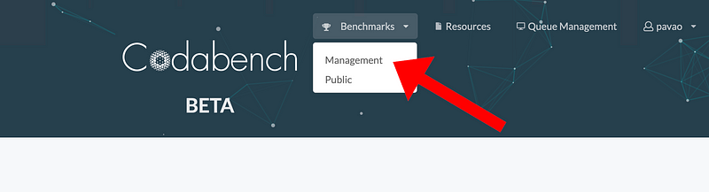
/// caption
Go to **Benchmarks**, then **Management** and finally **Upload**.
///

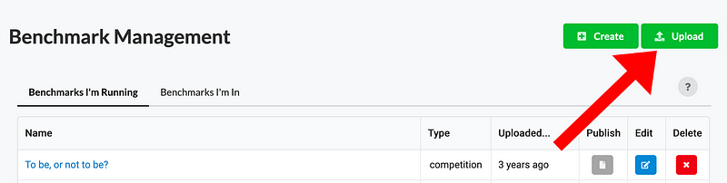
/// caption
Then click on the paper clip button to select and upload the bundle.
///

The main page of the benchmark should look like this:

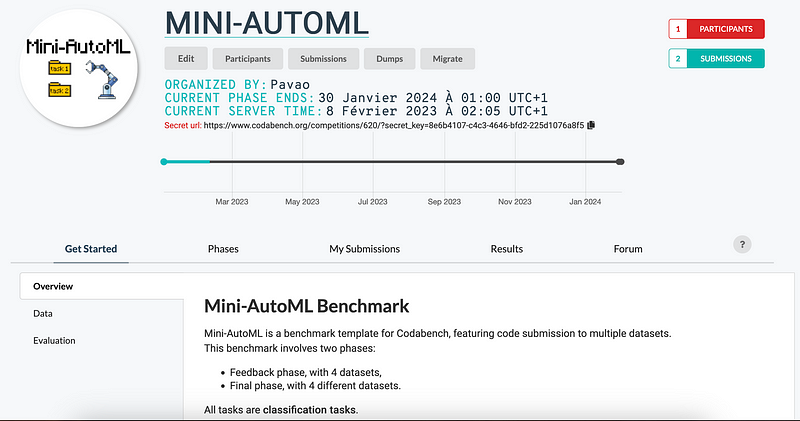
/// caption
Overview of Mini-AutoML main page.
///

Let's now make a submission. To do so, download the file [sample_code_submission.zip](https://github.com/codalab/competition-examples/blob/master/codabench/mini-automl/sample_code_submission.zip) and upload it in the **My Submissions** tab of the benchmark. You will be able to view logs in real time during the processing of the submission. The leaderboard, available in the **Results** tab of the benchmark, will then be updated.

## Customize the benchmark

> That's cool and all… but I just re-created the Mini-AutoML Benchmark. I want to design my own task and include my awesome dataset! — You

To customize your benchmark, you need to change the files contained in the bundle and re-upload it. The bundle contains everything that defines the benchmark: HTML files, logo, datasets, ingestion and scoring programs, starting kit and the settings file `competition.yaml`. The ingestion program manages code submissions while the scoring program is used to score submissions.

Even if your bundle is already uploaded, it is still possible to edit the benchmark! The editor is one of the organizer features, along with **Participants**, **Submissions**, **Dumps** and **Migrate**.

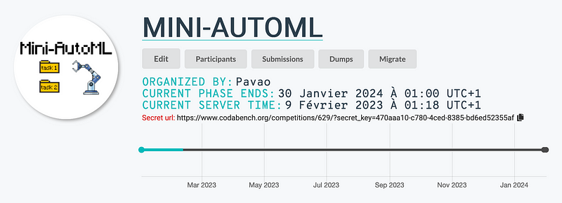
/// caption
As an organizer, you have access to many features, available from the grey buttons at the top of the benchmark page.
///

Click on **Edit** to start customizing this newly created benchmark. By navigating a bit inside this menu, you can see that everything can be edited: the title and description, HTML pages, leaderboard settings, and so on. Let's review some options.

### Fact sheets

In the first tab of the editor, you can enable "fact sheets" to gather more information about the submissions. Enabling fact sheets means that the participants will be asked to fill in some information when making submissions. You can fully customize the information fields, making them required or not, and choosing which information appears on the leaderboard. This can be used to display the name of the methods, the URL to the source code, or a description of the method. Gathering metadata about the methods used is crucial when conducting a benchmark, and this interface makes it simple to gather all this information in one place.

### Edit data and programs

Codabench provides an interface to upload *Ingestion Program*, *Scoring Program*, *Starting Kit*, *Data* (public/input/reference) etc.

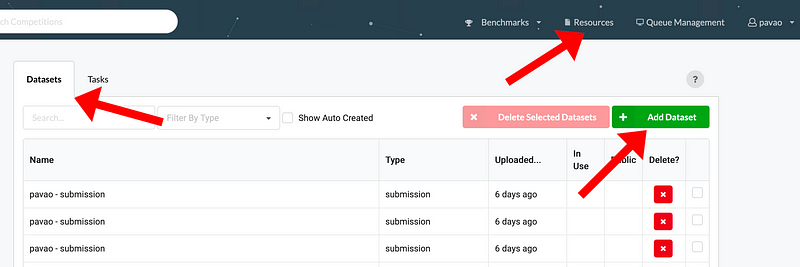
/// caption
To upload a new dataset or program, go to **Resources**, **Datasets** and click on **Add Dataset**. Then name it, select your ZIP file, and choose the type (reference data, scoring program, etc.)
///

Once these are uploaded, a task can be created using the uploaded files. A task is a combination of *Ingestion Program*, *Scoring Program*, *Input Data*, and *Reference Data*.

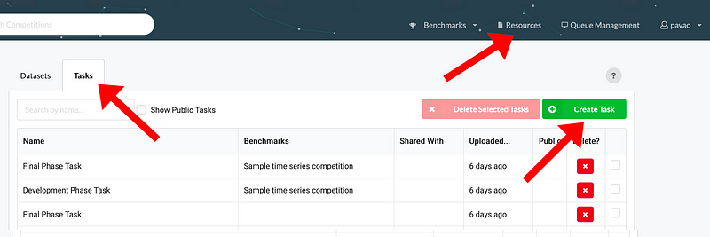
/// caption
To create a task, go to **Resources**, **Tasks** and click on **Create Task**. Then name it and select the files previously uploaded: input data, reference data, ingestion program and/or scoring program.
///

In your competition editor, you can add, update or delete a task for each phase. Unlike CodaLab, Codabench allows you to have multiple tasks for each phase.

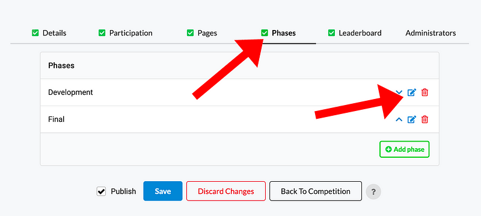
/// caption
Go to the editor, then **Phases** and click on the edit button.
///

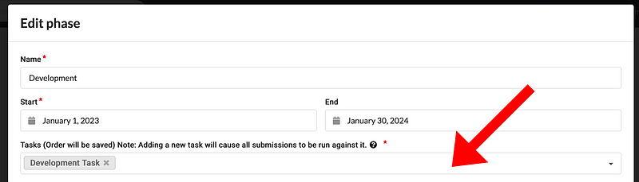
/// caption
You can now associate the desired task with the phase.
///

### Submission rules

The submission rule defines the behavior of the leaderboard regarding new submissions. Submissions can be forced to the leaderboard or manually selected, can be unique or multiple on the leaderboard, etc.
You can edit the submission rule as follows:

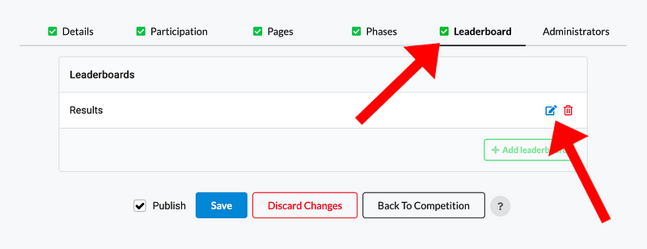
/// caption
To edit the submission rule, go to the editor, then **Leaderboard** and edit the leaderboard.
///

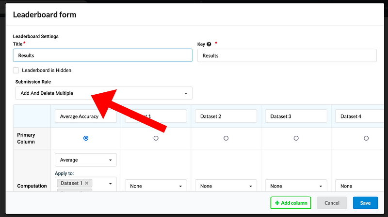
/// caption
Change the submission rule from **Force Last** to **Add And Delete Multiple**.
///

The current submission rule, **Force Last**, means that only the last submission of each participant will appear on the leaderboard. This is a classical setting for competitions. Changing this rule to **Add And Delete Multiple** allows the participants to manually select which submissions appear on the leaderboard, with multiple submissions per participant. See [Leaderboard Features](Leaderboard-Functionality.md) for all the available rules.

### Add submissions to the leaderboard

Now that the leaderboard is set up, let's submit different variations of the [code of the model](https://github.com/codalab/competition-examples/blob/master/codabench/mini-automl/bundle/solution/model.py) from the [sample_code_submission.zip](https://github.com/codalab/competition-examples/blob/master/codabench/mini-automl/sample_code_submission.zip). This example code submission simply calls a classifier from Scikit-Learn [1]. Replace the `DecisionTreeClassifier` with the classifier of your choice. Remember to differentiate the different submissions by filling the "Method name" in the fact sheet.

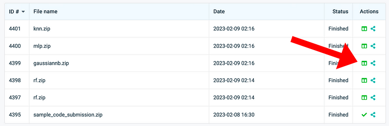
/// caption
Once your submission is processed, click on the leaderboard button under **Actions** in the submissions table to manually add it to the leaderboard.
///

The leaderboard finally looks like this:

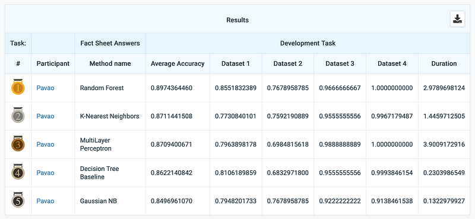
/// caption
The filled leaderboard. The random forest classifier did the best job in the first phase of the benchmark!
///

## Conclusion

Congratulations! You have learned the basics of Codabench, and now you can organize your own benchmarks! However, we barely scratched the surface of all the possibilities offered by this platform. To go further, check the [Advanced Tutorial](Advanced-Tutorial.md) and the rest of this documentation.

You will learn how to [link your own compute workers](../Running_a_benchmark/Compute-Worker-Management---Setup.md) (CPU, GPU), how to customize the ingestion and scoring programs, how to define [complex leaderboards](Leaderboard-Functionality.md) with multiple criteria, or even how to [deploy your own instance](../../Developers_and_Administrators/How-to-deploy-Codabench-on-your-server.md) of the platform. You can also join the effort and develop your own features!

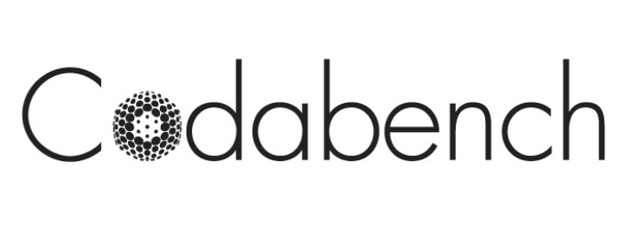

## References

[1] F. Pedregosa, G. Varoquaux, A. Gramfort, et al. *Scikit-learn: Machine learning in Python.* Journal of Machine Learning Research, 2011.
