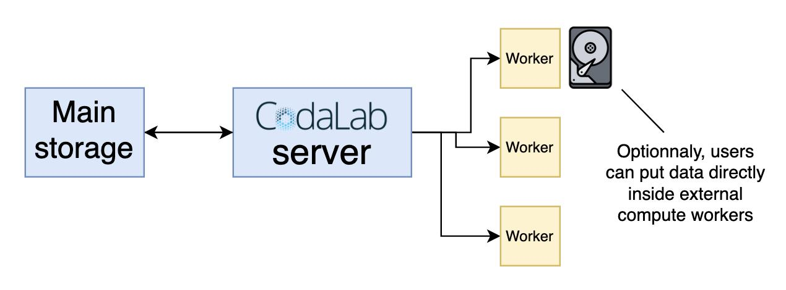

Compute workers are simply machines that are able to accept/send celery messages on the port used by the broker URL you wish to connect to that have a compute worker image, or other software to receive submissions. This means that you can add computing power to your competitions or benchmarks if needed! Any computer, from your own physical machines to virtual machines on cloud computing services can be used for this purpose. You can add multiple workers to a queue to process several submissions simultaneously.

You can find these images [here](https://hub.docker.com/r/codalab/codabench-compute-worker/tags)

## Requirements
=== "Docker"
    ### Docker
    Steps:

    - Have a machine (_either physical or virtual, 100 GB storage recommended_)
    - Install Docker
    - Pull Compute Worker Image
    - Run the compute worker via Docker


    Either:

    a) Install docker via the installation script: https://docs.docker.com/install/linux/docker-ce/ubuntu/#install-using-the-convenience-script

    ```bash
    curl https://get.docker.com | sudo sh
    sudo usermod -aG docker $USER
    ```

    b) Install manually, following the steps at: https://docs.docker.com/install/

    Create a `docker-compose.yml` file and paste the following content in it:

    ```yaml title="docker-compose.yml"
    # Codabench Worker
    services:
        worker:
            image: codalab/codabench-compute-worker:latest
            container_name: compute_worker
            volumes:
                - /codabench:/codabench
                - /var/run/docker.sock:/var/run/docker.sock
            env_file:
                - .env
            restart: unless-stopped
            hostname: ${HOSTNAME}
            logging:
                options:
                    max-size: 50m
                    max-file: 3

    ```

=== "Podman"
    ### Podman
    We need to install Podman on the Host. For this example, we use a Debian based OS.

    `sudo apt install podman `

    After installing Podman, you will need to launch the service associated with it with 

    ```bash
    systemctl --user enable --now podman
    ```

    Then, configure where Podman will download the images: Podman will use Dockerhub by adding this line into `/etc/containers/registries.conf`:

    ```ini
    unqualified-search-registries = ["docker.io"]
    ```

    You will also need to create the `codabench` folder defined in the `.env` file, as well as change its permissions to the user that is running the compute worker.

    ```bash title="In your terminal"
    sudo mkdir /codabench
    sudo mkdir /codabench/data
    sudo chown -R $(id -u):$(id -g) /codabench
    ```

    You should also run the following command if you don't want the container to be shutdown when you log out of the user:

    ```bash
    sudo loginctl enable-linger *username*
    ```
    Make sure to use the username of the user running the podman container.

    Create a `run_podman.sh` file with the following content:

    ```bash title="run_podman.sh"
    podman run -d \
    --volume /run/user/$(id -u)/podman/podman.sock:/run/user/1000/podman/podman.sock:U \
    --env-file .env \
    --name compute_worker \
    --security-opt="label=disable" \
    --userns host \
    --restart unless-stopped \
    --log-opt max-size=50m \
    --log-opt max-file=3 \
    --hostname ${HOSTNAME} \
    --cap-drop all \
    --volume /codabench:/codabench:U,z \
    codalab/codabench-compute-worker:latest
    ```

    Then run the command :

    ```bash
    chmod +x run_podman.sh
    ```

    !!! warning
        **To launch a Podman compatible GPU worker, you will need to have podman version 5.4.2 minimum**

!!! note 
    `hostname` allows you to set the hostname of the compute worker container, which will then be shown in the [server status](Server-status-page.md) page on Codabench (available to both you and the participants of your competition). This can be set to anything you want, by setting the `HOSTNAME` environment variable on the machine hosting the Compute Worker or changing `${HOSTNAME}` to something else

## CPU Worker configuration
You will get your Broker URL from the instance. More information about Queues [here](Queue-Management.md)

Make a file `.env` and put this in it:

=== "Docker"

    ```ini title=".env"
    #######################################################################
    #                       Connection URL                                #
    #######################################################################
    BROKER_URL=pyamqp://<login>:<password>@www.codabench.org:5672/
    # If SSL isn't enabled, then comment or remove the following line
    BROKER_USE_SSL=True

    #######################################################################
    #                       Temporary Storage                             #
    #######################################################################
    HOST_DIRECTORY=/codabench


    #######################################################################
    #                       Runtime                                       #
    #######################################################################
    CONTAINER_ENGINE_EXECUTABLE=docker
    #USE_GPU=True
    #GPU_DEVICE=nvidia.com/gpu=all
    #HUMAN_IN_THE_LOOP=False

    # If set to False, the compute worker will never pull for the 
    # competition image, the image will need to be downloaded
    # manually on the host before running submissions. True by default
    #COMPETITION_ALLOW_IMAGE_PULL=True

    # This option removes the ability of the compute worker to send logs to
    # codabench, instead writing them locally on disk. Combine with
    # COMPUTE_WORKER_NO_CLEANUP=true to stop the worker's cleanup to keep
    # all the logs locally only
    #COMPUTE_WORKER_DISABLE_LOG_UPLOAD=False

    # Stop the predictions from being sent to Codabench.
    # This option requires only having one compute worker for ingestion
    # and scoring.
    #COMPUTE_WORKER_DISABLE_PREDICTION_UPLOAD=False

    #COMPUTE_WORKER_NO_CLEANUP=False

    #######################################################################
    #                       Network                                       #
    #######################################################################
    #COMPETITION_CONTAINER_NETWORK_DISABLED=False

    #COMPETITION_CONTAINER_HTTP_PROXY=http://example_proxy:123
    #COMPETITION_CONTAINER_HTTPS_PROXY=https://example_proxy:1233
    ```

=== "Podman"

    ```ini title=".env"
    #######################################################################
    #                       Connection URL                                #
    #######################################################################
    BROKER_URL=pyamqp://<login>:<password>@www.codabench.org:5672/
    # If SSL isn't enabled, then comment or remove the following line
    BROKER_USE_SSL=True

    #######################################################################
    #                       Temporary Storage                             #
    #######################################################################
    HOST_DIRECTORY=/codabench


    #######################################################################
    #                       Runtime                                       #
    #######################################################################
    CONTAINER_ENGINE_EXECUTABLE=podman
    #USE_GPU=True
    #GPU_DEVICE=nvidia.com/gpu=all
    #HUMAN_IN_THE_LOOP=False

    # If set to False, the compute worker will never pull for the
    # competition image, the image will need to be downloaded
    # manually on the host before running submissions. True by default
    #COMPETITION_ALLOW_IMAGE_PULL=True

    # This option removes the ability of the compute worker to send logs to
    # codabench, instead writing them locally on disk. Combine with
    # COMPUTE_WORKER_NO_CLEANUP=true to stop the worker's cleanup to keep
    # all the logs locally only
    #COMPUTE_WORKER_DISABLE_LOG_UPLOAD=False

    # Stop the predictions from being sent to Codabench.
    # This option requires only having one compute worker for ingestion
    # and scoring.
    #COMPUTE_WORKER_DISABLE_PREDICTION_UPLOAD=False

    #COMPUTE_WORKER_NO_CLEANUP=False

    #######################################################################
    #                       Network                                       #
    #######################################################################
    #COMPETITION_CONTAINER_NETWORK_DISABLED=False

    #COMPETITION_CONTAINER_HTTP_PROXY=http://example_proxy:123
    #COMPETITION_CONTAINER_HTTPS_PROXY=https://example_proxy:1233
    ```


By default, the competition container created by the compute worker has access to internet. If you want to remove this access, you can uncomment `COMPETITION_CONTAINER_NETWORK_DISABLED` and set it to `True`

If the VM hosting the compute worker is behind a proxy, and you want to allow the competition container to access internet, you will also need to set the proxy for the competition container to use, in which case you can use `COMPETITION_CONTAINER_HTTP_PROXY`

To control the scoring output before sending it to the instance, you can use the human in the loop feature to check the scoring file (json or txt) before sending anything to the instance, see: [HITL documentation](Competition-HITL.md)

!!! note
    - The broker URL is a unique identifier of the job queue that the worker should listen to. To create a queue or obtain the broker URL of an existing queue, you can refer to [Queue Management](Queue-Management.md) docs page.

    - `/codabench` -- this path needs to be volumed into `/codabench` on the worker, as you can see below. You can select another location if convenient.

## GPU Worker configuration
Make a `.env` file, as explained in CPU worker configuration instructions.

!!! warning
    Don't forget `USE_GPU=true` in the `.env`

Then, install the NVIDIA toolkit:
[Nvidia toolkit installation instructions](https://docs.nvidia.com/datacenter/cloud-native/container-toolkit/latest/index.html)

If you have multiple Nvidia GPUs, you can uncomment `#GPU_DEVICE=nvidia.com/gpu=all` and put the name of the GPU you want the compute worker to use. You can get the name by launching the following command :
```bash
nvidia-ctk cdi list
```

!!! tip
    Make sure to add the necessary packages inside the competition image to allow the use of the connected GPU

## Start the Worker
=== "Docker"
    You can then launch the worker by running this command in the terminal where the `docker-compose.yml` file is located:

    ```bash
    docker compose up -d
    ```

=== "Podman"
    You can launch the worker by running this command in the terminal where the `run_podman.sh` file is located:

    ```bash
    ./run_podman.sh
    ```


## Check logs

Use the following command to check logs and ensure everything is working fine:

=== "Docker"

    ```bash
    docker logs -f compute_worker
    ```
=== "Podman"

    ```bash
    podman logs -f compute_worker
    ```

## Cleaning up periodically

It is recommended to clean up docker images and containers regularly to avoid filling up the storage.

1. Run the following command:

```bash
sudo crontab -e
```

2. Add the following line:

=== "Docker"

    ```bash
    @daily docker system prune -af
    ```

=== "Podman"

    ```bash
    @daily podman system prune -af
    ```

---

## Optional: Put data directly inside the compute worker
### Datasets
The folder `$HOST_DIRECTORY/data`, usually `/codabench/data`, is shared between the host (the compute worker) and the container running the submission (a new container is created for each submission). It is mounted inside the container as `/app/data`. This means that you can put data in your worker, in `$HOST_DIRECTORY/data`, so it can be read-only accessed during the job's process. You'll need to modify the scoring and/or ingestion programs accordingly, to point to `/app/data`. This is especially useful if you work with confidential data, or with a heavy dataset.

!!! note "If you have several workers in your queue, remember to have the data accessible for each one."



### Reference Data
You can also add your reference data, used during the scoring phase, inside a folder on the compute worker. This folder, `$HOST_DIRECTORY/reference`, will be mounted during the scoring phase as `/app/reference` inside the container. Contrary to `$HOST_DIRECTORY/data`, this folder is only mounted during the scoring phase. 

!!! warning "Do not put reference data in `$HOST_DIRECTORY/data`"
    `/app/data` is also mounted during ingestion, where participant code runs, so anything in it can be read by submissions. Use `$HOST_DIRECTORY/reference` for anything participants must not see.

!!! warning 
    Make sure to make the owner of the folder(s) and file(s) the same as the one launching the compute worker.  
       - `root` for Docker rootful  
       - `codabench` for Podman and Docker rootless if you created a user named `codabench` to launch podman and docker rootless from


!!! tip "If you simply wish to set up some compute workers to increase the computing power of your benchmark, you don't need to scroll this page any further."

---

## Building compute worker

This is helpful only if you want to build the compute worker image. It is not needed if you simply want to set up compute workers to run submissions.
To build the image, you will first need to clone the Codabench repository:
```sh
git clone https://github.com/codalab/codabench.git
```

Then, to build the default image:

=== "Docker"

    ```bash
    cd codabench
    docker build -t *account_name*/codabench-compute-worker:latest -f packaging/container/Containerfile.compute_worker .
    ```

=== "Podman"

    ```bash
    cd codabench
    podman build -t *account_name*/codabench-compute-worker:latest -f packaging/container/Containerfile.compute_worker .
    ```
To update the image on your container registry:

=== "Docker"

    ```bash
    docker push *repository_name*/*account_name*/codabench-compute-worker:latest
    ```

=== "Podman"

    ```bash
    podman push *repository_name*/*account_name*/codabench-compute-worker:latest
    ```

!!! note "If you have running compute workers, you'll need to update all your workers with the new image manually."

## Update the compute worker image

If the compute worker docker image was updated, you can reflect the changes using the following commands.

Check no job is running:

=== "Docker"

    ```sh
    docker ps
    ```
=== "Podman"

    ```sh
    podman ps
    ```

Update the worker:

=== "Docker"

    ```sh
    docker compose down
    docker compose pull
    docker compose up -d
    ```

=== "Podman"

    ```sh
    podman stop compute_worker
    podman pull codalab/codabench-compute-worker:latest
    ./run_podman.sh
    ```