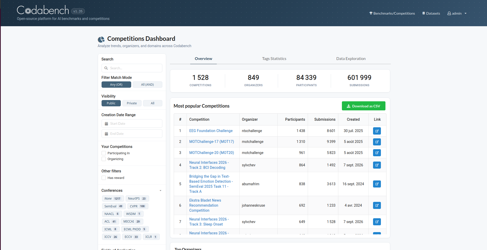
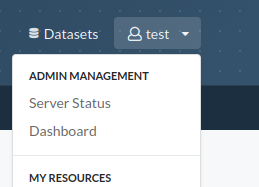
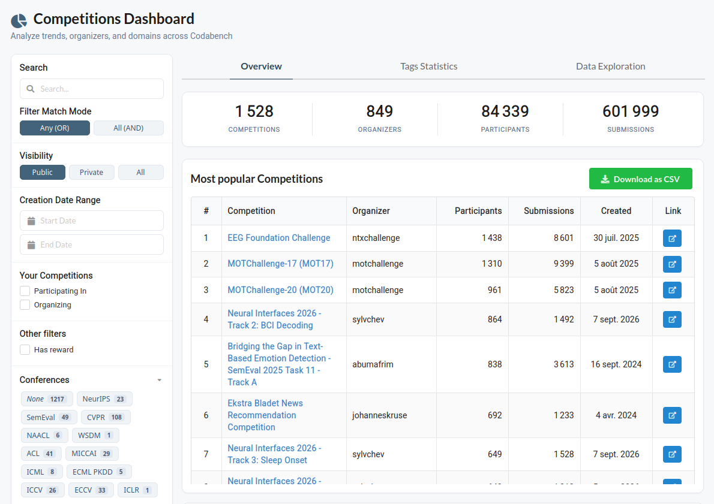
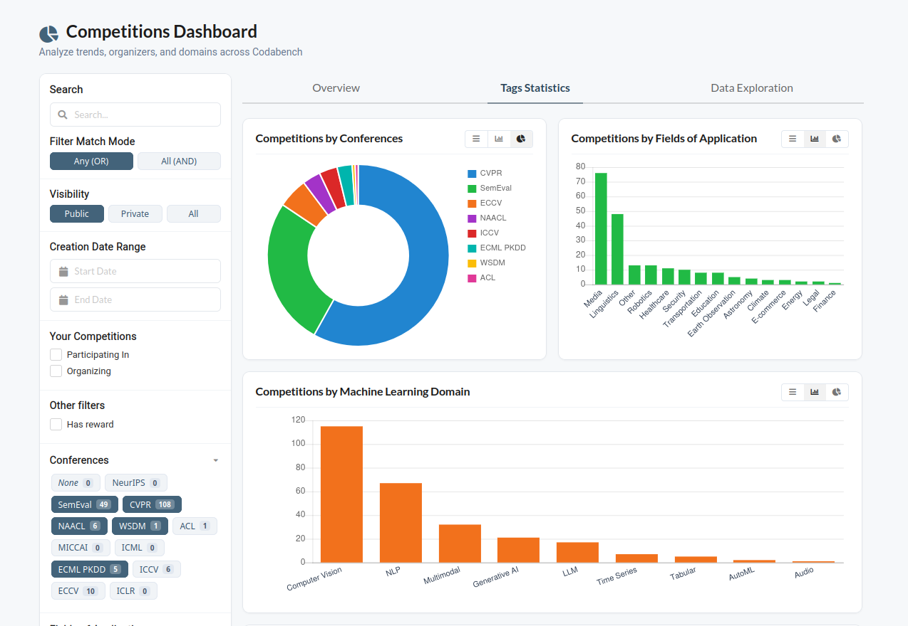
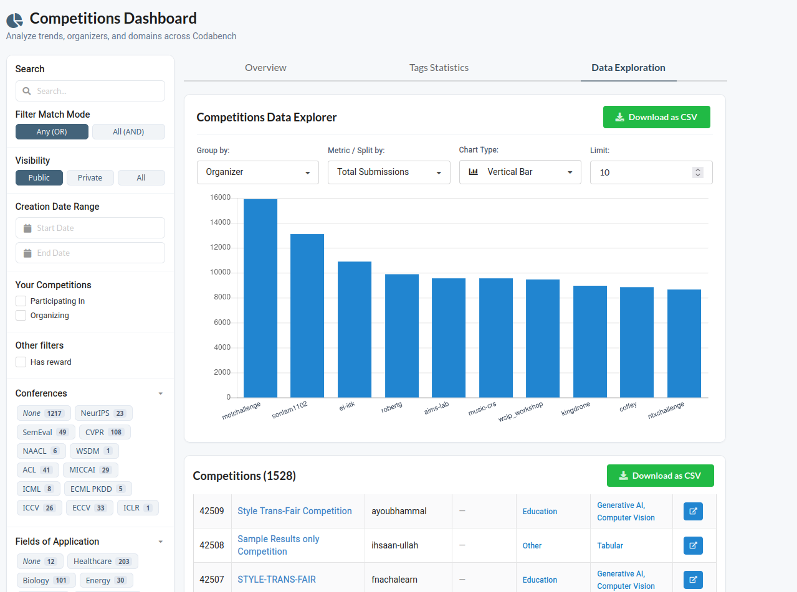
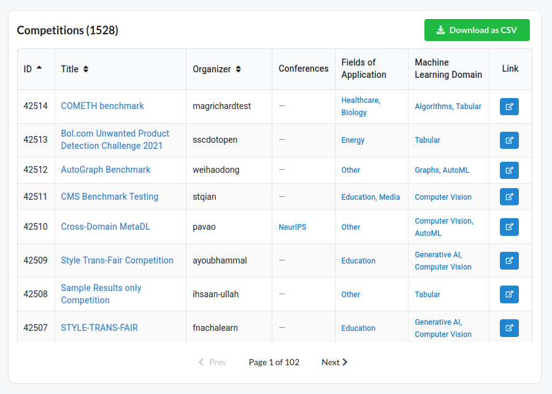

# Competitions Dashboard

This page will show you how to use the **Competitions Dashboard** to explore platform metrics, filter benchmarks, and analyze trends across Codabench.

You can access the dashboard by clicking on **Dashboard** in the user menu at the top right of the navigation bar, or directly at [codabench.org/dashboard/](https://www.codabench.org/dashboard/):

---

## Filter panel

The panel on the left allows you to filter the competitions displayed across the entire dashboard.

- **Search**: Enter text to filter competitions by title, description, or keyword.
- **Filter Match Mode**: Choose between **Any (OR)** to match competitions having at least one selected tag, or **All (AND)** to match competitions having all selected tags.
- **Creation Date Range**: Select a start and end date to view competitions created within a specific timeframe.
- **Your Competitions**: Use the checkboxes to view only competitions you are participating in or organizing.
- **Has reward**: When checked, displays only competitions offering prizes or awards.
- **Tag Categories**: Click on any category (e.g. topics, conferences, application fields) to expand its list of tags. The badge number next to each tag shows how many matching competitions have that tag.

!!! tip "Real-time updates"
    Any filter you select will immediately update the metrics, charts, and tables across all three tabs.

---

## Overview tab

This tab gives you a high-level overview of platform activity and popular competitions.

At the top of the tab, four summary counters show the total number of competitions, organizers, participants, and submissions matching your current filters.

### Most popular Competitions
This table lists the most active competitions on the platform ranked by participant count and submissions. You can click on any competition title or the external link icon to open its detail page, or click the green **Download as CSV** button to export the ranked list.

### Top Organizers
This section highlights the most active competition creators and organizations on Codabench.

### Cumulative Competition Launches Over Time
This chart illustrates overall platform growth by plotting the cumulative total of competitions created month by month.

### Competition Launches
This bar chart shows the volume of new competitions launched over time. You can use the interval dropdown to group launches by **Yearly**, **Semiannual**, **Monthly**, or **Weekly**, and adjust the date pickers to focus on a specific time range.

---

## Tags Statistics tab

This tab allows you to explore how competitions are distributed across the categories and tags configured on the platform.

### Category Breakdown Charts
Each card displays the distribution of competitions across tags for a given category. You can switch between **Bar chart**, **Pie / Donut chart**, and **Table view** using the toggle buttons in the top-right corner of each card.

### Cumulative Occurrences over Time
This multi-line chart tracks how the adoption of tags within a selected category has grown over time. You can use the dropdown to switch between different tag categories.

### Tag Co-occurrence Heatmap
This color-coded matrix visualizes how frequently tags from two different categories appear together in the same competitions. You can use the **Rows** and **Cols** dropdowns to select which categories to compare, and check the **Normalize** box to view row-normalized percentages instead of raw counts.

---

## Data Exploration tab

This tab provides interactive tools to build custom charts, cross-tabulate data, and export competition records.

### Data Explorer
The Data Explorer allows you to create custom visualizations by choosing what dimensions and metrics to aggregate:

- **Group by**: Select the primary dimension along the main axis. You can group by individual competitions, organizers, reward status, creation year, or any tag category.
- **Metric / Split by**: Choose what to measure or cross-tabulate:
    - You can aggregate single metrics like competition counts, total or average participants, and total or average submissions.
    - You can also choose **Split by** to break down the primary dimension by reward status or by another tag category. When a split is active, clickable category pills appear above the chart so you can toggle specific categories on or off.
- **Chart Type**: Select your preferred visualization format, including **Horizontal Bar**, **Vertical Bar**, **Line**, **Doughnut / Pie**, or **Tabular**. In tabular view, you can click on any column header to sort the data.
- **Limit**: Set the maximum number of items to display in the chart, or leave it blank to show all entries.
- **Download as CSV**: Click this button to export the plotted chart or table data as a CSV file.

### Competitions Table
Located below the chart, this table lists all individual competitions matching your active filters.

- **Columns**: Displays the competition ID, clickable title, organizer, and assigned tags for each category.
- **Sorting**: Click on the **ID**, **Title**, or **Organizer** column headers to sort the table.
- **Link**: Clicking the blue link button opens the competition detail page in a new tab.
- **Download as CSV**: Click this button to export the entire list of filtered competitions with their metadata and tags as a CSV file.
